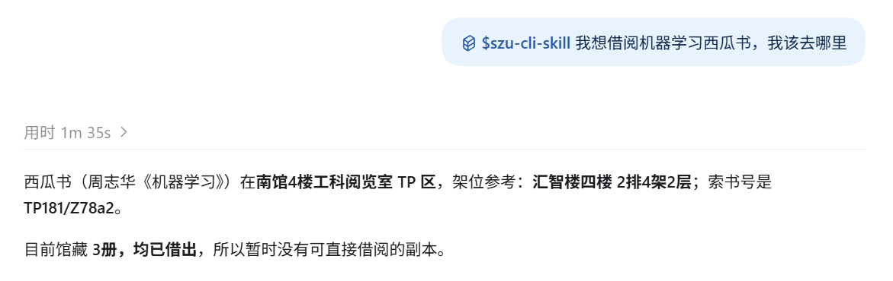
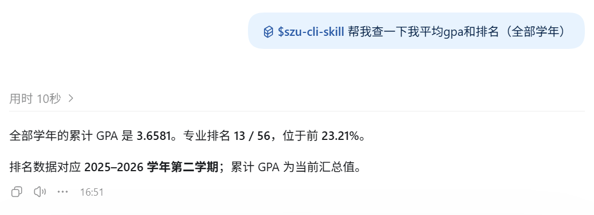
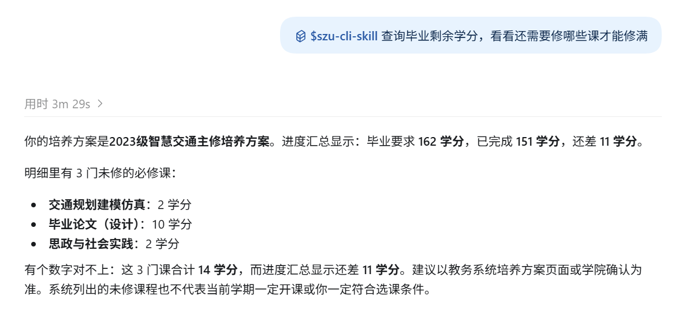
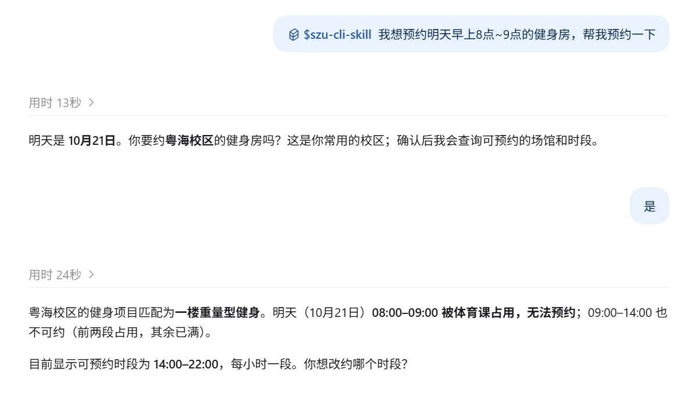
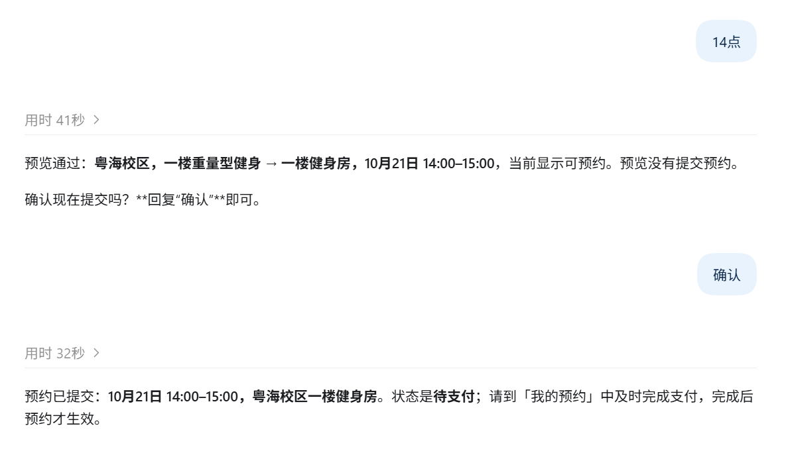

#  SZU-CLI

[](README.md)
[](README_EN.md)
[](package.json)
[](LICENSE)

`szu-cli` 是面向深圳大学网页服务的 agent-friendly CLI。

它把常用校园网页能力整理成稳定命令和结构化 JSON 输出，同时复用本机持久化浏览器登录态，不保存账号密码。

CLI 和 Skill 由深大学生自行制作，非官方，如有任何问题可在 [github.com/AwesomeHou/szu-cli](https://github.com/AwesomeHou/szu-cli) 上进行反馈或通过电子邮件与我取得联系。

## 安装与快速开始

要求 Node.js 20 或更高版本，并确保 `npm`/`npx` 可用。

### 快速开始（人类用户）

#### 从 npm 安装（推荐）

```bash
npx szu-cli@latest install
```

> 该命令会完成两件事：
>
> 1. 将 `szu-cli@latest` 安装到 npm 全局路径，使 `szu-cli` 命令可以直接使用。
> 2. 从当前 npm 包自带的 `skills/szu-cli-skill` 安装文件，通过 `npx skills add` 将 Skill 全局安装到当前环境中可识别的主流 AI Agent。
>
> 支持的 Agent 及其项目级、全局 skill 目录请参阅 [Supported Agents](https://github.com/vercel-labs/skills/blob/main/README.md#supported-agents)，包括 Codex、Claude Code、Cursor 等。WorkBuddy 用户安装 CLI 后，可运行 `szu-cli skill install --target workbuddy` 安装 Skill。

初始化浏览器登录态：

```bash
szu-cli auth login
szu-cli auth status
```

### 快速开始（AI Agent）

以下步骤面向正在协助用户操作的 AI Agent；登录步骤需要用户在浏览器中完成。

第 1 步 — 安装：

```bash
npx szu-cli@latest install
```

第 2 步 — 检查运行环境：

```bash
szu-cli doctor
```

第 3 步 — 登录：

```bash
szu-cli auth login
```

第 4 步 — 验证登录态：

```bash
szu-cli auth status
```

`auth login` 会打开一个持久化浏览器 profile。你在正常网页里完成登录后，后续命令会复用 `~/.szu-cli/browser-profiles/<browser>/` 下的登录态。

所有命令默认输出 JSON；`--json` 仍可作为旧调用的兼容参数。浏览器会优先使用用户选择或系统默认的 Chrome/Edge，并为 Chrome、Edge、Chromium 保存独立的 CLI profile。

当前支持 Google Chrome、Microsoft Edge 和 Playwright Chromium；Safari、Firefox 及其他默认浏览器不会被直接复用。

查看浏览器状态，或在没有可用 Chrome/Edge 时按确认安装 Playwright Chromium：

```bash
szu-cli browser status
szu-cli browser install chromium --yes
```

如需使用 Edge：

```powershell
$env:SZU_BROWSER='edge'
szu-cli auth login
```

### 仅安装CLI或skill

仅安装 CLI：

```bash
npm install --global szu-cli
```

仅安装 skill：

```bash
npx --yes skills add https://github.com/AwesomeHou/szu-cli --skill szu-cli-skill --yes --global
```

## 当前能力

| 模块 | 实现的功能 | 示例命令 |
|---|---|---|
| 环境与认证 | 检查运行环境、浏览器后端和当前登录状态 | `szu-cli doctor`<br>`szu-cli auth status` |
| 公文通 | 查询公告列表、搜索公告并读取正文和附件信息 | `szu-cli notice list --limit 10`<br>`szu-cli notice search 奖学金` |
| 个人课表 | 查询本学期课表或当天课程 | `szu-cli course list`<br>`szu-cli course today` |
| 全校课表与培养方案 | 查询班级课表、培养方案及课程模块 | `szu-cli timetable classes --limit 5`<br>`szu-cli program list --limit 5` |
| 成绩与学业进度 | 查询成绩、GPA、思政学分和培养方案完成情况 | `szu-cli grade list`<br>`szu-cli completion summary` |
| 创新领航讲座 | 查询可报名讲座、讲座详情和个人学习进度 | `szu-cli lecture list`<br>`szu-cli lecture progress` |
| 体育预约 | 查询项目、时段和实际可预约场馆/场地；唯一候选自动选择，多个候选可用 `--field` 指定 | `szu-cli sports fields --campus 粤海校区 --venue 羽毛球 --date 2026-07-08 --slot 20:00-21:00`<br>`szu-cli sports reserve --campus 粤海校区 --venue 羽毛球 --date 2026-07-08 --slot 20:00-21:00 --field "羽毛球场 A4" --dry-run` |
| 宿舍电费 | 查询可用楼栋及指定房间的用电余额 | `szu-cli electricity query --campus 深大新斋区 --building 红豆斋 --room 838` |
| 图书馆馆藏 | 搜索图书并查询馆藏位置、索书号和借阅状态 | `szu-cli library search 交通设计`<br>`szu-cli library item 3706432` |
| 知网 | 在用户可见浏览器中检索论文元数据和详情 | `szu-cli cnki search 交通设计 --headed` |
| 万方 | 在用户可见浏览器中检索论文元数据和详情 | `szu-cli wanfang search 交通设计 --headed` |

更多命令请看英文版 [README](README_EN.md) 和 [CLI 契约](docs/cli-contract.md)。

## 使用示例

### 查询图书馆馆藏

通过自然语言查找图书，获取馆藏位置、索书号和借阅状态。



### 查询 GPA 与专业排名

汇总全部学年的 GPA 和专业排名。



### 查看毕业学分进度

查看培养方案的学分完成情况和未修课程。



### 预约健身房

先查询可预约时段并预览预约信息，确认后提交；预约提交后仍需按场馆要求完成支付。





## 设计方向

```text
Agent 或用户
  -> szu-cli 命令契约
  -> 校园事务模块
  -> 直接校园网访问
  -> Playwright 持久化浏览器 profile
  -> 深圳大学网页系统
```

skill 只负责告诉 agent 何时、如何安全调用 `szu-cli`。核心登录态、网页解析和校园业务逻辑都放在 CLI 中。

## 安全边界

- 不收集账号密码。
- 不绕过登录、验证码、校园网络限制、访问控制或频率限制。
- 默认优先实现只读能力。
- 不做高频抓取或批量下载。
- 状态变更命令必须先支持 `--dry-run`。`sports reserve` 和 `sports cancel` 的真实状态变更都必须显式 `--confirm`，不自动支付、不取消支付。
- 不把 cookies、浏览器 profile、截图、HAR、trace 等本地敏感文件提交到 Git。

## 文档

- [架构](docs/architecture.md)
- [CLI 契约](docs/cli-contract.md)
- [安装](docs/installation.md)
- [登录态](docs/login-state.md)
- [发布检查](docs/release.md)
- [安全与合规](docs/security-and-compliance.md)
- [Skill 集成](docs/skill-integration.md)
- [路线图](docs/roadmap.md)

## 贡献与反馈

欢迎提交功能建议、Bug 报告和文档改进。

- 通过 [GitHub Issues](https://github.com/AwesomeHou/szu-cli/issues) 反馈问题或建议。提交前先搜索已有 issue；Bug 请说明运行环境、复现命令、预期结果和实际结果，注意不要附带账号、Cookie 或浏览器 profile。
- 提交 PR 时，先 Fork 仓库并从 `develop` 创建主题分支；保持改动聚焦，同时更新受影响的命令文档和 skill。
- 提交前运行 `npm test` 和 `npm run docs:check`，然后推送分支并通过 [创建 Pull Request](https://github.com/AwesomeHou/szu-cli/compare) 发起 PR。请在描述中写明改动范围、验证结果和关联 issue。
## 许可证

MIT
